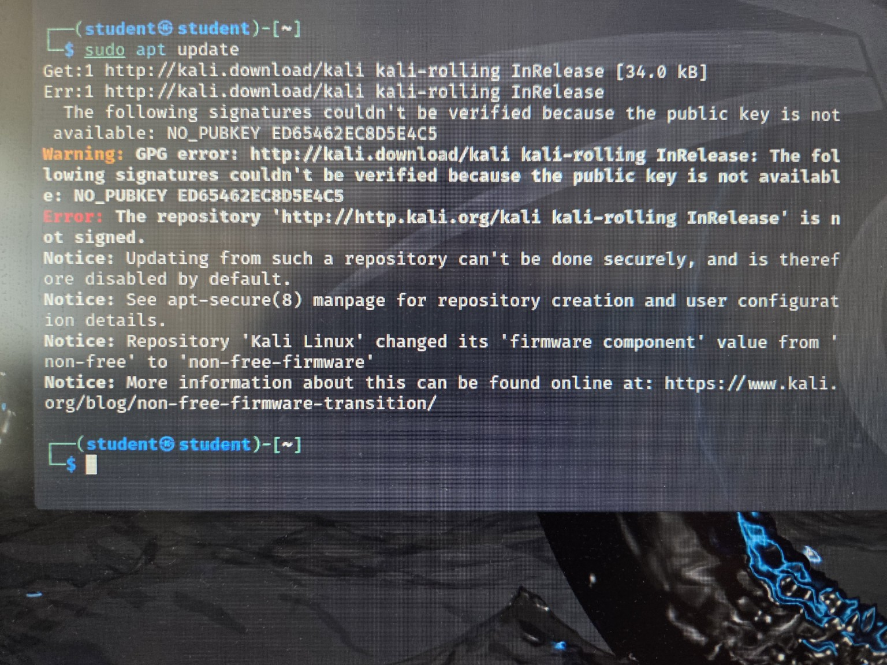

## Ошибка



## В чём проблема?
Главная ошибка:
NO_PUBKEY ED65462EC8D5E4C5

Это означает, что Kali Linux не может проверить цифровую подпись репозитория, потому что отсутствует необходимый GPG-ключ.

GPG-ключ нужен для проверки того, что обновления действительно поступают из доверенного источника Kali Linux.

Из-за отсутствия ключа система блокирует обновление в целях безопасности.

## Как исправить

Шаг 1. Открой терминал и введи:
```
wget https://archive.kali.org/archive-keyring.gpg -O /tmp/kali-archive-keyring.gpg
```

Эта команда скачает официальный набор ключей Kali Linux.

Шаг 2. Установи скачанный ключ:
```
sudo install -m 644 /tmp/kali-archive-keyring.gpg /usr/share/keyrings/kali-archive-keyring.gpg
```

Шаг 3. Повтори обновление:
```
sudo apt update
```
sudo apt update

Если всё прошло успешно, ошибка NO_PUBKEY должна исчезнуть.